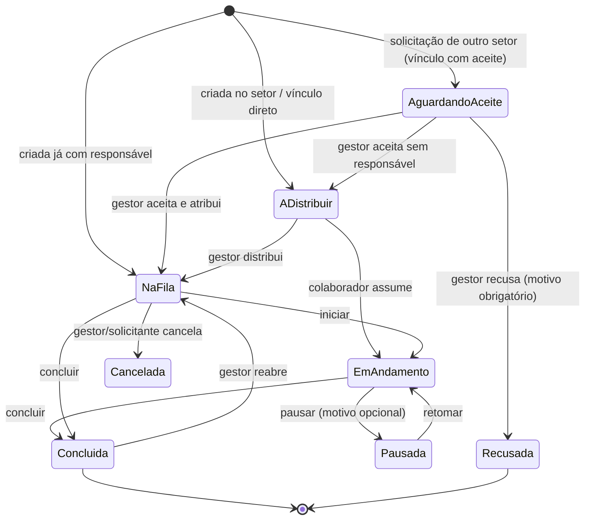
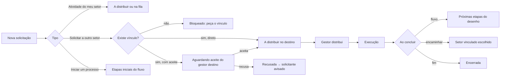

# 2. Regras de negócio e processos

Este documento descreve o modelo de processo implementado, na visão de análise de processos. Todas as regras ficam em `web/src/lib/servico.ts` e `web/src/lib/regras.ts`, e as permissões são reforçadas no banco (`supabase/migrations`).

## 2.1 Papéis

| Capacidade | Colaborador | Gestor do setor | Administrador (diretoria) |
|---|:-:|:-:|:-:|
| Ver e executar a própria fila (iniciar, pausar, concluir) | ✔ | ✔ | ✔ |
| Assumir uma atividade "a distribuir" do próprio setor | ✔ | ✔ | ✔ |
| Criar atividade no próprio setor (para si ou para distribuição) | ✔ | ✔ | ✔ |
| Solicitar a setores **vinculados** | ✔ | ✔ | ✔ (qualquer setor) |
| Iniciar um fluxo de processo | ✔ | ✔ | ✔ |
| Aceitar, recusar e distribuir atividades do setor | — | ✔ | ✔ |
| Programar férias, delegar e devolver atividades | — | ✔ (sua equipe) | ✔ |
| Criar e remover vínculos | — | ✔ (setores envolvidos) | ✔ |
| Desenhar fluxos de processo | — | ✔ | ✔ |
| Setores, pessoas, logotipo e integrações | — | — | ✔ |

Uma pessoa pode ser gestora de mais de um setor. O painel mostra um seletor para alternar entre eles.

## 2.2 Ciclo de vida da atividade

| Status | Significado | Quem age |
|---|---|---|
| **Aguardando aceite** | Chegou de outro setor e ainda não foi aceita | Gestor do setor executor |
| **A distribuir** | Aceita (ou interna), sem responsável | Gestor distribui ou colaborador assume |
| **Na fila** | Tem responsável e ainda não começou | Responsável |
| **Em andamento** | Sendo executada | Responsável |
| **Pausada** | Interrompida, com motivo registrado | Responsável |
| **Concluída** / **Recusada** / **Cancelada** | Encerradas | Gestor pode reabrir |

**Atrasada** é uma condição, não um status: a atividade está aberta e o prazo é anterior a hoje.

## 2.3 Fluxo de solicitação (como a demanda entra)

O formulário sempre mostra a caixa **"O que vai acontecer"**, que explica para quem vai a atividade e se precisa de aceite.

## 2.4 Vínculos entre setores (regra de roteamento)

- Um **vínculo A → B** autoriza o setor A a **solicitar** e a **encaminhar entregas** para B.
- Cada vínculo define se **exige aceite** do gestor de B ou se a atividade tem **entrada direta** (cai em "A distribuir").
- Sem vínculo, a solicitação é **bloqueada**, exceto para a diretoria e para quem é gestor do destino.
- Criar, alterar ou remover um vínculo **notifica os dois gestores**.
- Remover um vínculo **não afeta** as atividades em curso; só impede novas solicitações por esse caminho.
- Os vínculos são desenhados no **mapa da empresa**: puxe a bolinha azul de um setor até outro. Para remover, selecione a ligação e use o botão ou a tecla Delete.

## 2.5 Fluxos de processo (modelos desenhados)

Um fluxo é um grafo com **Início**, **Etapas** e **Fim**. Cada etapa tem setor, prazo em dias e a opção de exigir aceite.

| Regra | Comportamento |
|---|---|
| Início do processo | São criadas todas as etapas ligadas ao Início (podem ser várias, em **paralelo**). |
| Conclusão de etapa | **Todas** as ligações de saída disparam. Uma ligação para o Fim encerra aquele ramo. |
| Convergência | Uma etapa com várias entradas só é criada quando **todas** as etapas anteriores do processo estiverem encerradas. É criada uma única vez. |
| Aceite | A etapa chega como "Aguardando aceite" quando exige aceite, muda de setor e quem conclui não é o gestor do destino. Caso contrário, chega como "A distribuir". |
| Prazo | Data de chegada mais o prazo da etapa, em dias. |
| Recusa | Encerra aquele ramo. O solicitante e o gestor de origem são avisados. |
| **Edição do fluxo** | A próxima etapa é calculada **no momento da conclusão**. Por isso, ligar ou desligar etapas muda imediatamente as regras, inclusive para processos já em andamento. Etapas removidas que tinham atividades em curso são encerradas sem gerar sucessor. O editor avisa quando isso vai acontecer. |
| Validação | O editor impede iniciar fluxos com erro: sem Início ou Fim, etapa sem setor, etapa sem saída, ou nenhum caminho até o Fim. Ciclos geram apenas um aviso, porque são permitidos para retrabalho. |

## 2.6 Encaminhamento avulso

Atividades que não vêm de um fluxo podem ter **"Encaminhar ao concluir para"**: o setor é definido na criação, pelo arraste no mapa da empresa ou na hora de concluir. A atividade só pode ser encaminhada para setores **vinculados** ao setor executor. O processo mantém o mesmo identificador e aparece na trilha.

## 2.7 Distribuição

- O gestor distribui pelo botão **Distribuir** ou **arrastando** o cartão entre as colunas das pessoas.
- A lista de pessoas mostra quantas atividades abertas cada uma tem e quem está **ausente**.
- Devolver para distribuição remove o responsável e volta o status para "A distribuir".

## 2.8 Férias, licenças e delegação

1. O gestor registra a ausência: pessoa, tipo, período e substituto principal.
2. O sistema lista as atividades da pessoa que estão **na fila, em andamento ou pausadas**. Para cada uma, o gestor escolhe entre manter, delegar a um colega do setor ou devolver para distribuição.
3. Regras da delegação:
   - atividades em andamento delegadas voltam para "Na fila" do substituto;
   - o **responsável original** fica gravado;
   - não pode haver duas ausências sobrepostas para a mesma pessoa;
   - colegas também ausentes no período aparecem sinalizados.
4. No retorno, **Devolver atividades** devolve tudo o que ainda estiver aberto para a pessoa original.
5. A pessoa, o substituto e cada novo responsável recebem notificação.

## 2.9 Notificações

| Evento | Quem recebe |
|---|---|
| Solicitação aguardando aceite | Gestor do setor de destino |
| Atividade chegou para distribuição | Gestor do setor |
| Atividade atribuída, distribuída ou delegada | Novo responsável |
| Solicitação aceita ou recusada | Quem solicitou e o gestor do setor solicitante |
| Atividade concluída | Quem criou e o gestor do setor |
| Prazo alterado, cancelada, reaberta | Responsável |
| Novo comentário | Responsável, solicitante e gestor |
| Vínculo criado, alterado ou removido | Gestores dos dois setores |
| Acesso liberado | A pessoa aprovada |

Toda notificação aparece no **sino**. Se as integrações estiverem ativas e o perfil permitir, ela também é enviada por **e-mail** e/ou postada no **canal do Teams** do setor da pessoa (ou no canal geral). Ninguém é notificado das próprias ações.

## 2.10 Indicadores

| Indicador | Cálculo |
|---|---|
| Abertas | Status diferente de concluída, recusada ou cancelada |
| Aguardando aceite / A distribuir / Na fila / Em andamento | Contagem por status ("Na fila" inclui as pausadas) |
| Ocupação (barra de "Em andamento") | Em andamento ÷ (na fila + em andamento + pausadas) |
| Atrasadas | Abertas com prazo anterior a hoje |
| Concluídas (30 dias) | Concluídas nos últimos 30 dias |
| Entregues no prazo | Concluídas em até a data de prazo ÷ concluídas (30 dias) |
| Tempo médio de entrega | Média de (conclusão − criação), em dias, nas concluídas dos últimos 30 dias |

Ao clicar em um indicador, a lista de atividades abre já filtrada.
