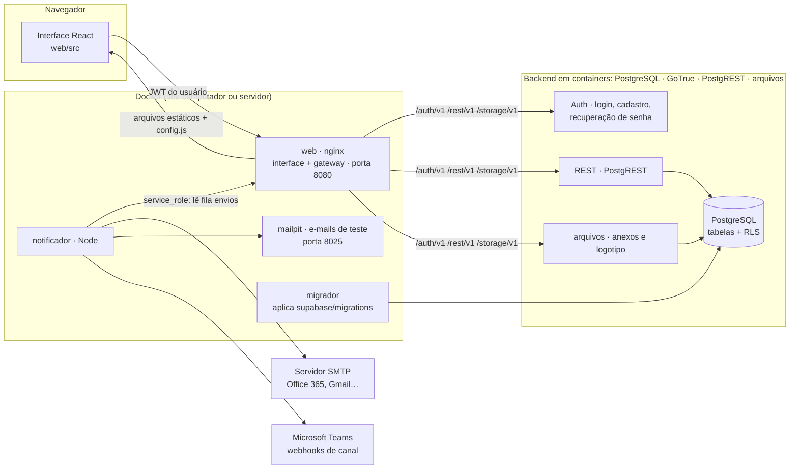

# 4. Arquitetura e segurança

## Componentes

| Componente | Responsabilidade | Tecnologia |
|---|---|---|
| `web/` | Telas, regras de negócio (`lib/servico.ts`), validação de fluxos, cliente Supabase | React 19, TypeScript, esbuild, CSS próprio (design system em `styles.css`) |
| `supabase/` | Tabelas, índices, **RLS**, gatilhos, buckets do Storage | PostgreSQL 15+ |
| `notificador/` | Lê `envios` pendentes e entrega por SMTP e Teams, com 3 tentativas | Node 20, sem dependências |
| `mailpit` | Caixa de e-mail de testes local (login e notificações) | axllent/mailpit |
| `db` | PostgreSQL puro | postgres:17-alpine |
| `auth`, `rest` | Login (GoTrue, do Supabase) e API REST (PostgREST) | supabase/gotrue, postgrest/postgrest |
| `arquivos` | Anexos e logotipo, com links assinados e validação do token do usuário; mesma API usada pelo Supabase Storage na nuvem | Node 20, sem dependências |
| `migrador` | Aplica as migrações (idempotentes) toda vez que o sistema sobe | postgres:17-alpine |

## Decisões de projeto

1. **Regras de negócio em um único serviço** (`Servico`), usado pelas telas e pelos testes. Ele trabalha sobre uma interface de repositório (`Repo`) com duas implementações:
   - `SupabaseRepo` (produção), que usa as APIs HTTP oficiais do Supabase (Auth, PostgREST, Storage) sem biblioteca externa;
   - `DemoRepo` (demonstração), com os dados no navegador.
2. **Segurança no banco**: mesmo que alguém chame a API diretamente, a RLS impede ações indevidas:
   - criar atividade em nome de outro;
   - editar atividade de setor alheio;
   - ler webhooks;
   - virar administrador;
   - ler notificações de terceiros.
   A mudança de papel, setor e status de acesso é protegida por gatilho.
3. **Fila de saída (`envios`)**: as telas só enfileiram. O envio real é feito pelo notificador com a chave de serviço, então os segredos (SMTP, webhooks) **nunca chegam ao navegador**.
4. **Fluxos como dados (`fluxos.definicao` em JSON)**: o próximo passo é calculado na conclusão. Por isso, editar o desenho muda as regras imediatamente.
5. **Configuração em tempo de execução**: o container `web` gera o `config.js` a partir do `.env`, e o nginx dele também é o gateway das APIs (o mesmo papel do Kong no Supabase). Assim a interface usa a mesma origem e funciona em qualquer endereço da rede sem configuração.
6. **Atualização**: as telas recarregam a cada 20 segundos, ao voltar o foco para a janela e após cada ação. É simples e robusto para equipes de até algumas centenas de pessoas.

## Modelo de permissões (RLS) — resumo

| Tabela | Leitura | Escrita |
|---|---|---|
| `empresa` | todos, inclusive no login | admin |
| `perfis` | usuários ativos; o próprio perfil sempre | o próprio perfil (sem papel/setor/ativo) ou admin |
| `setores` | ativos | admin; gestor edita o próprio setor (não troca o gestor) |
| `vinculos` | ativos | admin ou gestor de um dos setores |
| `fluxos` | ativos | gestores e admin |
| `atividades` | ativos | criar: `criado_por = você`; editar: admin, gestor do setor, responsável, criador ou quem assume uma atividade "a distribuir" do próprio setor |
| `notificacoes` | só as suas | qualquer ativo cria; você marca as suas |
| `ausencias` | ativos | gestor do setor da pessoa ou admin |
| `teams_webhooks` | admin | admin |
| `envios` | admin (registro) | qualquer ativo enfileira; o notificador atualiza |
| Storage `anexos` | ativos | ativos enviam; remoção controlada pela tabela `anexos` |
| Storage `marca` | público | admin |

As políticas foram testadas em PostgreSQL 16 com usuários simulados: colaborador, gestor, admin, cadastro pendente e anônimo.

## Limites conhecidos e próximos passos sugeridos

| Hoje | Evolução sugerida |
|---|---|
| Atualização das telas por intervalo (20 s) | Supabase Realtime (websocket) para atualização instantânea |
| Regras aplicadas pela interface, com RLS como barreira | Mover transições críticas para funções SQL (`rpc`) e ter auditoria completa no banco |
| Fluxos com execução paralela e convergência, sem condições | Ligações condicionais ("aprovado / reprovado") e SLA com escalonamento |
| Teams por webhook de canal | Bot do Teams para mensagens diretas e aprovação dentro do Teams |
| Carga de todos os dados da empresa por sessão | Paginação e filtros no servidor quando houver dezenas de milhares de atividades |
