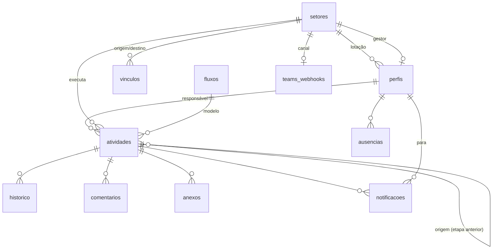

# 5. Modelo de dados

Definição completa em `supabase/migrations/20261025000000_planner_inicial.sql`.

| Tabela | Campos principais | Observações |
|---|---|---|
| `empresa` | `nome`, `logo_url` | Linha única (`id = 1`) |
| `perfis` | `nome`, `email`, `cargo`, `setor_id`, `papel` (admin/gestor/colaborador), `ativo`, `notif_email`, `notif_teams` | Criado automaticamente ao cadastrar no Auth; o primeiro vira admin |
| `setores` | `nome`, `cor`, `descricao`, `gestor_id`, `pos_x`, `pos_y` | Posição no mapa da empresa |
| `vinculos` | `origem_id`, `destino_id`, `requer_aceite`, `descricao` | Único por par; origem ≠ destino |
| `fluxos` | `nome`, `descricao`, `ativo`, `definicao` (JSON) | `definicao = { nos: [{id, tipo: inicio/etapa/fim, x, y, titulo, setor_id, prazo_dias, requer_aceite}], arestas: [{id, de, para, rotulo}] }` |
| `atividades` | `numero` (sequencial), `titulo`, `descricao`, `setor_id`, `responsavel_id`, `status`, `prioridade`, `inicio`, `prazo`, `criado_por`, `solicitante_setor_id`, `origem_id`, `processo_id`, `fluxo_id`, `etapa_id`, `encaminhar_para`, `motivo`, `responsavel_original_id`, `iniciado_em`, `concluido_em` | `processo_id` agrupa todas as etapas de uma mesma demanda entre setores |
| `historico` | `atividade_id`, `texto`, `autor_id` | Trilha de auditoria funcional |
| `comentarios` | `atividade_id`, `texto`, `autor_id` | — |
| `anexos` | `atividade_id`, `nome`, `caminho`, `tamanho`, `tipo` | Arquivo no bucket `anexos` (privado; download por link assinado de 1 h) |
| `notificacoes` | `para_id`, `titulo`, `texto`, `atividade_id`, `lida` | — |
| `ausencias` | `pessoa_id`, `tipo` (ferias/licenca/folga/outro), `inicio`, `fim`, `substituto_id`, `delegado`, `devolvido` | Sem sobreposição por pessoa (validado no serviço) |
| `integracoes` | `email_ativo`, `teams_ativo`, `app_url` | Linha única |
| `teams_webhooks` | `setor_id` (nulo = canal geral), `url`, `ativo` | Só o admin acessa |
| `envios` | `canal`, `para_id`, `setor_id`, `assunto`, `corpo`, `link`, `status` (pendente/enviado/erro/ignorado), `erro`, `tentativas` | Fila do notificador |
